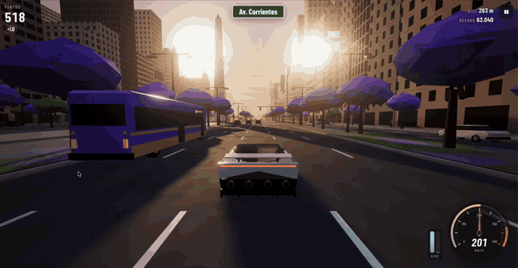

# Un Roadster por la 9 de Julio

> 🇦🇷 Español · [🇬🇧 English below](#english)

Juego web 3D de manejo libre por la **Avenida 9 de Julio** de Buenos Aires, al atardecer de octubre, con los jacarandás en flor. Manejás un hiperdeportivo eléctrico con **propulsores de aire comprimido**: saltá sobre el tránsito, hacé un **giro de 360°** en el aire y usá los propulsores traseros para pasar los 370 km/h. Pasá el Obelisco para sumar bonus y un checkpoint.



> **GIF pendiente.** Para grabarlo: `npm run dev`, abrí el juego en una ventana de 1280×720, jugá unos 10 s (salto con giro + propulsores) y grabá con [Peek](https://github.com/phw/peek), ScreenToGif o OBS. Convertilo con `ffmpeg -i clip.mp4 -vf "fps=24,scale=960:-1" docs/gameplay.gif` y guardalo en `docs/gameplay.gif`.

## Características

- Avenida infinita generada por cuadras recicladas: carriles del Metrobus con paradas, canteros con jacarandás, calles laterales, sendas, flechas, semáforos funcionales, carteles de calles reales (Av. Corrientes, Av. de Mayo, Tucumán, Lavalle…), pórticos de señalización, publicidades de marcas **inventadas** y el **Obelisco** con proporciones reales.
- Tránsito con IA: colectivos de colores con números de línea inventados, taxis negro y amarillo, autos, motos de delivery y camionetas. Respetan semáforos, mantienen distancia (Intelligent Driver Model), ponen el guiño antes de cambiar de carril y prenden las luces de freno. También cruza tránsito transversal con el semáforo en rojo para la avenida.
- Física arcade escrita a mano: inercia, agarre lateral, derrape leve, inclinación y suspensión visual. La aceleración se **calibra sola** con los valores de `src/config.ts` (0–97 km/h en 1,6 s; 0,78 s con propulsores (0–100 en 0,80 s)). Para verificarlo: `npm run check:accel`.
- Salto, salto con giro (doble Espacio, sin demora de entrada), cámara lenta en el punto más alto, estela de partículas, polvo al aterrizar y bonus por aterrizaje limpio.
- Atardecer dorado y modo noche, niebla que toma el color del cielo, sombras que siguen al jugador, bloom, FXAA/MSAA, viñeta, desenfoque radial y líneas de velocidad.
- Audio 100 % sintetizado con WebAudio: motor eléctrico, propulsores, bocinas y el tic del semáforo peatonal.
- Calidad Alta/Media/Baja/Auto con resolución dinámica.

## Controles

| PC | Acción |
|---|---|
| `W` / `↑` | Acelerar |
| `S` / `↓` | Frenar / reversa |
| `A` `D` / `←` `→` | Girar |
| `Espacio` | Salto |
| `Espacio` ×2 (< 300 ms) | Salto con giro 360° |
| `Shift` o `F` | Propulsores traseros (mantener) |
| `C` | Cámara persecución / capó |
| `N` | Atardecer / noche |
| `M` | Sonido |
| `Esc` / `P` | Pausa |

**Celular** (se detecta solo): joystick a la izquierda para la dirección; botones ACELERAR, FRENO, SALTO (doble toque = giro) y PROPULSORES a la derecha. Es multitouch real (podés acelerar, girar y usar los propulsores a la vez) y vibra donde está disponible. Se juega en horizontal.

## Stack

Vite · TypeScript (estricto) · Three.js · WebAudio. Todo el arte es procedural (geometría y texturas en canvas generadas por código); no hay assets externos. Hay un loader opcional de `.glb` en `src/entities/models.ts` (configurá `models.playerCarUrl` en `src/config.ts`).

```
src/
  config.ts      todas las constantes del juego
  game/          loop, estados, puntaje, calidad
  world/         avenida, cruces, semáforos, edificios, árboles, Obelisco, Metrobus
  entities/      auto del jugador, tránsito, peatones
  physics/       modelo de manejo, salto y giro, colisiones
  input/         teclado, táctil, doble pulsación
  fx/            atmósfera, partículas, post-processing, cámara
  audio/         motor de audio WebAudio
  ui/            HUD, velocímetro, tanques, menús, compartir
```

## Cómo correrlo

```bash
npm install
npm run dev        # http://localhost:5173
npm run build      # typecheck + build de producción en dist/
npm run preview
npm run check:accel
```

Parámetros de desarrollo: `?play` (arranca directo), `?night`, `?auto` (piloto automático), `?carview=<grados>` (inspección del auto), `?og&carview=18&r=10&h=0.8&boostfx` (escena de la imagen Open Graph).

## Deploy en Vercel

1. Subí el repo a GitHub.
2. En Vercel, elegí **Add New → Project** e importá el repo. Detecta Vite solo (también está `vercel.json`): build `npm run build`, salida `dist`.
3. Actualizá la URL absoluta de `og:image`, `og:url` y `twitter:image` en `index.html` con tu dominio final.

## Disclaimer

**Proyecto de fans, no afiliado a ninguna marca automotriz.** El diseño del auto está inspirado en un hiperdeportivo eléctrico presentado en 2026. No usa nombres, logos ni imágenes de ninguna marca, y el modelo se genera por código. Todas las marcas de las publicidades son inventadas.

Licencia [MIT](LICENSE).

---

## English

A free, browser-based 3D driving game set on **Avenida 9 de Julio** in Buenos Aires, at golden hour in October with the jacarandas in bloom. You drive an electric hypercar with **compressed-air thrusters**: jump over traffic, pull a **360° barrel roll** mid-air and fire the rear thrusters past 370 km/h. Passing the Obelisk gives a bonus and a checkpoint.

**Controls (PC):** W/↑ accelerate · S/↓ brake/reverse · A-D/←-→ steer · Space jump · double Space spin jump · Shift/F rear thrusters · C camera · N day/night · M mute · Esc/P pause.
**Mobile:** left virtual joystick for steering; ACCELERATE, BRAKE, JUMP (double tap = spin) and THRUSTERS buttons on the right, with true multitouch. Play in landscape.

**Stack:** Vite, strict TypeScript, Three.js and WebAudio. All art is procedural, with no external assets.
**Run:** `npm install && npm run dev`. **Build:** `npm run build`. **Deploy:** import the repo in Vercel (it auto-detects Vite and outputs to `dist`), then update the absolute OG URLs in `index.html`.

**Disclaimer:** fan project, not affiliated with any car maker. The car design is inspired by an electric hypercar unveiled in 2026; it uses no names, logos or images of any brand. All advertised brands are fictional. MIT license.
